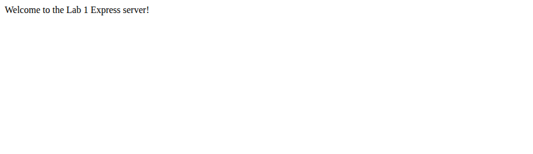
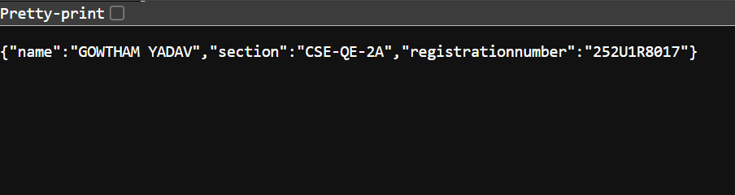
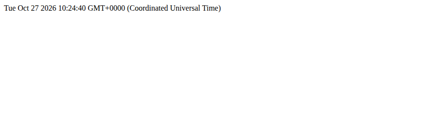
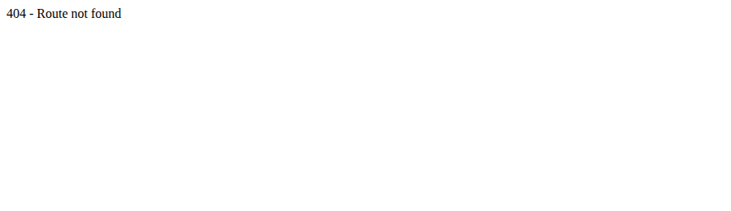

# Lab 1: Node.js and Express server

**Name:** GOWTHAM YADAV · **Registration number:** 252U1R8017 · **Section:** CSE-QE-2A

**Live link:** https://college-labs.onrender.com

## How to run

```bash
# 1. go into the folder
cd lab-01
# 2. install dependencies (creates node_modules)
npm install
# 3. start the Express server
npm start            # runs: node server.js
# (optional) run the plain http version instead
npm run plain        # runs: node plain-server.js
```

Server runs on **http://localhost:3000**. Environment variables: optional `PORT` (defaults to 3000). No secrets are needed.

## package.json fields

| Field | Meaning |
| --- | --- |
| name | Name of the project/package |
| version | Current version (major.minor.patch) |
| description | Short text about the project |
| main | Entry-point file of the project |
| scripts | Shortcut commands run with `npm run <name>` (`npm start`) |
| keywords | Words that help people find the package |
| author | Who wrote it |
| license | Usage licence (ISC by default) |
| dependencies | Packages the project needs to run (Express) |

## Endpoints

| Method | Path | Description | Status |
| --- | --- | --- | --- |
| GET | `/` | Welcome text | 200 |
| GET | `/about` | JSON with name and section | 200 |
| GET | `/time` | Current date and time (`new Date()`) | 200 |
| GET | any other path | "404 - Route not found" message | 404 |

## Screenshots






## Notes: problems faced and how I solved them

- Unknown-path 404 handler must be written after all routes, otherwise it catches everything.
- Added `.gitignore` so `node_modules` and `.env` are never committed.
