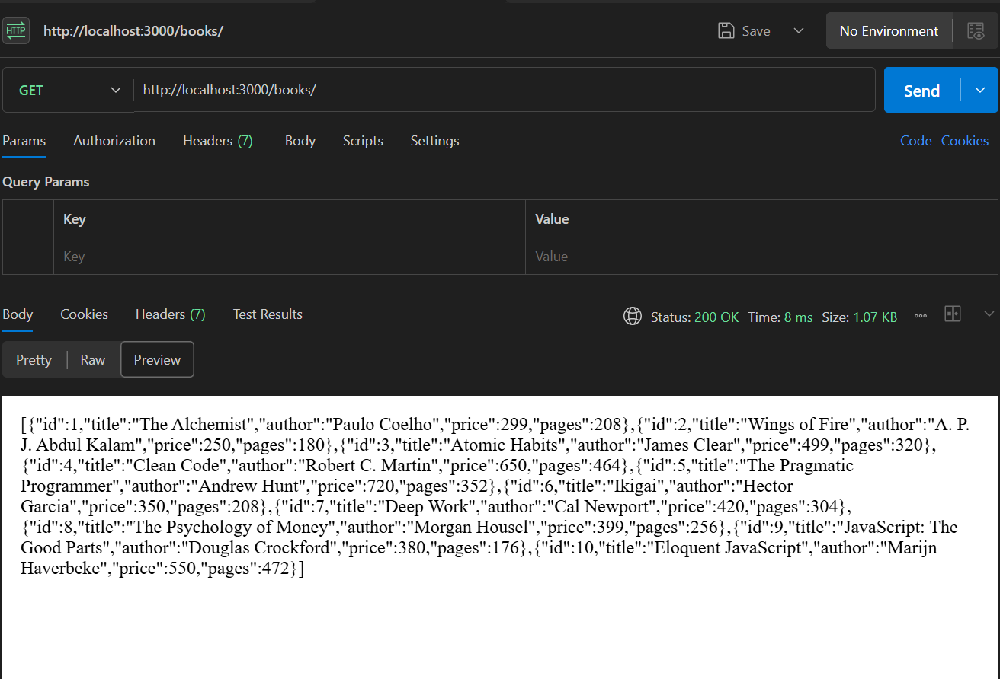
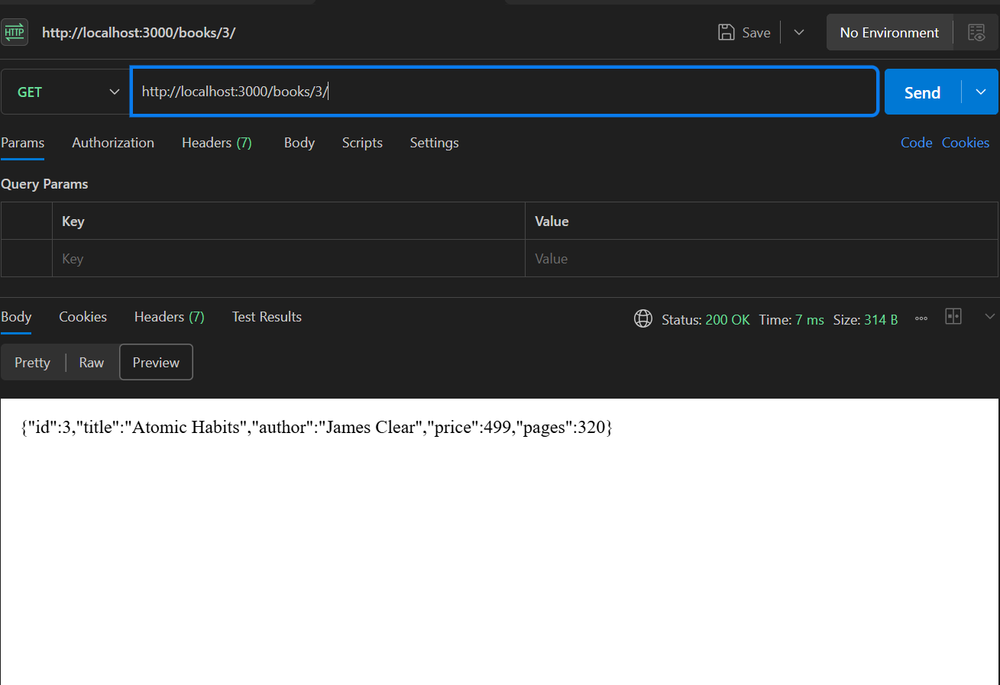
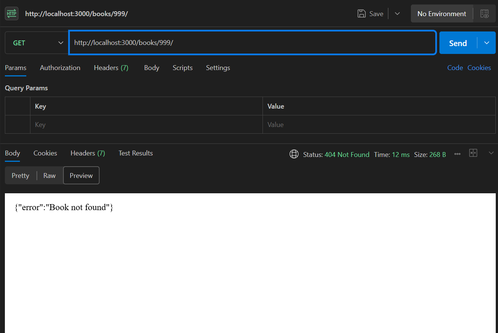
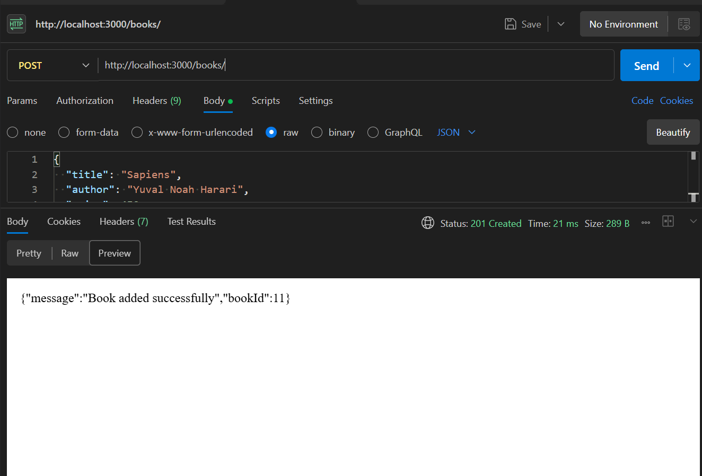
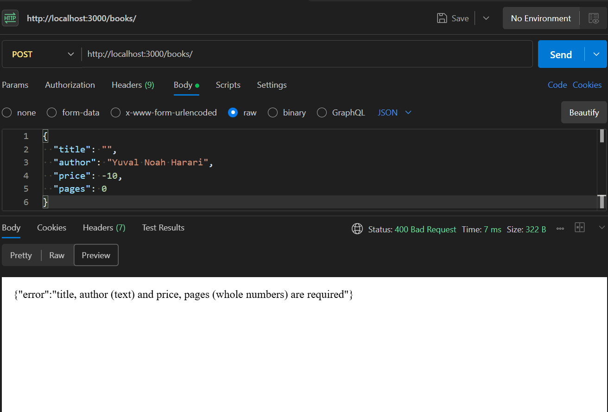
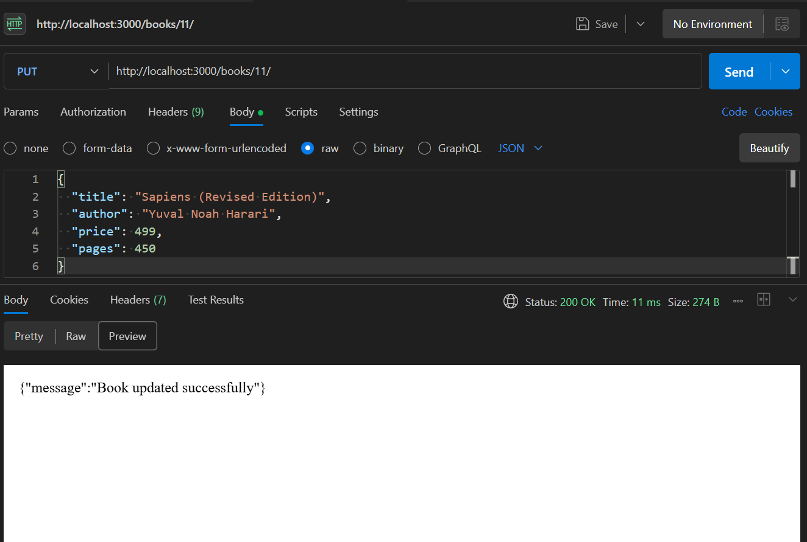
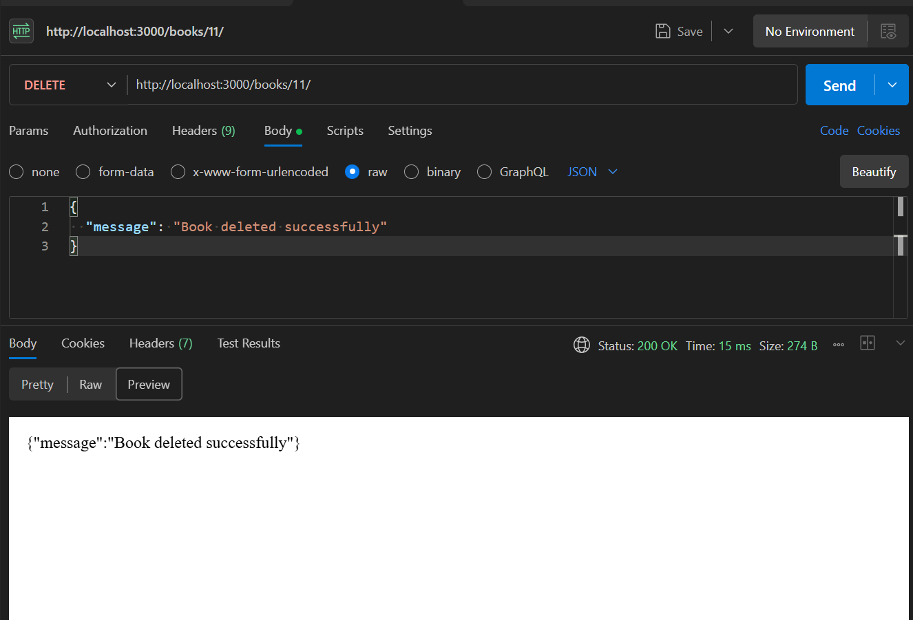
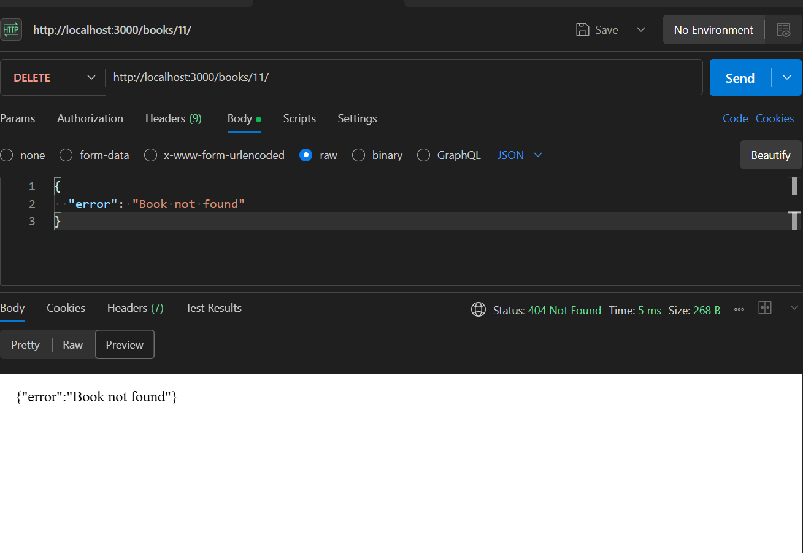
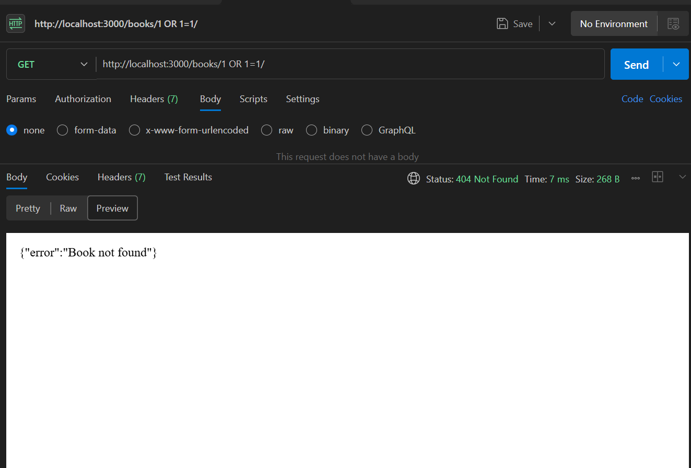
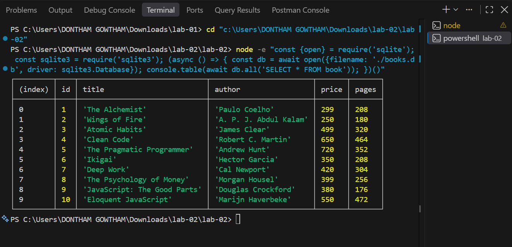

# Lab 2: SQLite database and CRUD routes

**Name:** GOWTHAM YADAV · **Registration number:** 252U1R8017 · **Section:** CSE-QE-2A

**Live link:** https://backend-lab-02-1rcc.onrender.com/books/

## How to run

```bash
cd lab-02
npm install              # installs express, sqlite, sqlite3, nodemon
npm start                # node index.js
npm run dev              # nodemon index.js (restarts on every change)
```

- Server: **http://localhost:3000**
- Environment variables: optional `PORT` (default 3000). No secrets needed.
- Database: `books.db` (SQLite file, table `book`). To recreate it from the SQLite CLI:
  ```bash
  sqlite3 books.db < setup.sql
  ```

## Database

`book(id INTEGER PRIMARY KEY, title TEXT, author TEXT, price INTEGER, pages INTEGER)` with 10 sample rows from `setup.sql`.

## Endpoints

| Method | Path | Description | Success | Errors |
| --- | --- | --- | --- | --- |
| GET | `/books/` | Get all books | 200 | – |
| GET | `/books/:bookId/` | Get one book | 200 | 404 not found |
| POST | `/books/` | Add a new book (JSON body) | 201 | 400 invalid body |
| PUT | `/books/:bookId/` | Update a book (JSON body) | 200 | 400 invalid body, 404 not found |
| DELETE | `/books/:bookId/` | Delete a book | 200 | 404 not found |
| any | other path | Unknown route | – | 404 |

JSON body for POST and PUT:
```json
{ "title": "Sapiens", "author": "Yuval Noah Harari", "price": 450, "pages": 443 }
```

## Screenshots












## Notes: problems faced and how I solved them

- Server starts only after the DB connection succeeds (`initializeDBAndServer`), otherwise routes would run with `db = null`.
- Used `?` placeholders in every query that takes user input, so input like `1 OR 1=1` is treated as plain text.
- Added validation (400), not-found checks (404) and a JSON-error handler so every route returns the right status code.
- `.gitignore` excludes `node_modules/` and `.env`.
- Port 3000 conflicts were resolved by configuring optional environment port fallback.
